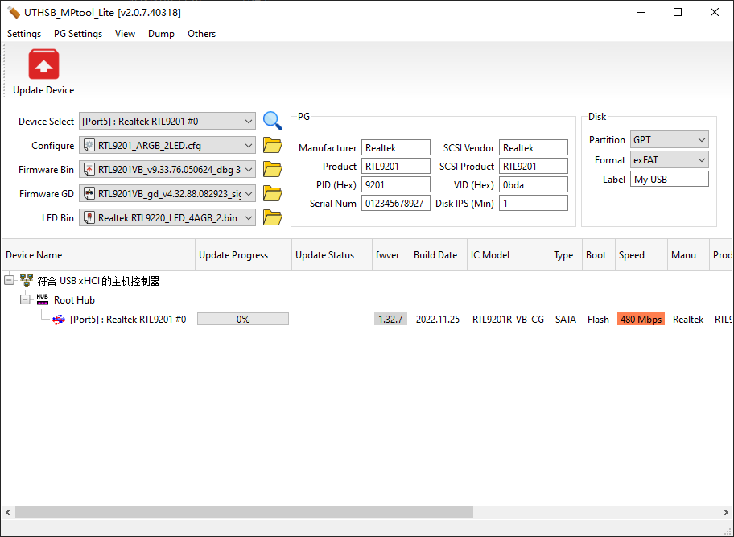
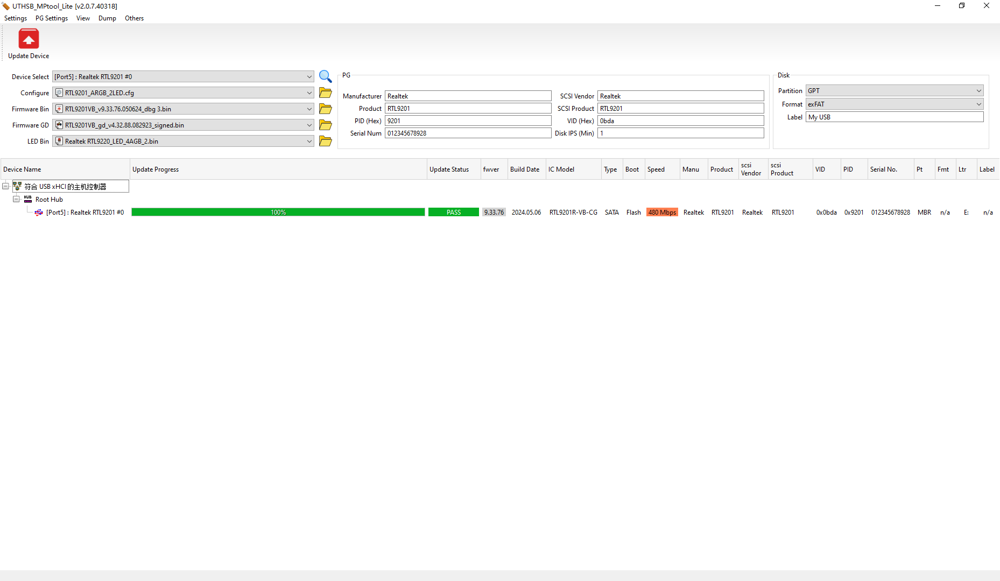
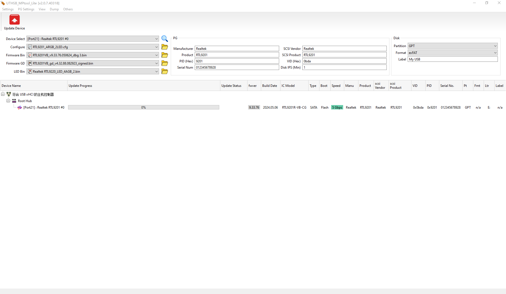

# Realtek-RTL9201R-Firmware-Tool

针对RTL9201芯片的固件集合和刷机工具。

## 背景

手上有一个白牌的2.5寸透明硬盘盒，Type-c3.1接口，芯片型号 RTL9201R, 带2颗固态电容版本（就是图它的电容）。

目录说明：
```text
Configure      可修改配置参数
FirmwareBin    主固件
FirmwareGB     全局参数包
LedBin         灯效控制固件
```

## 一、固件说明


`RTL9201VB_v9.33.76.050624_dbg 3.bin` 文件名拆分：

- `RTL9201VB`：适配 **VB 硅片**（在用的版本，不是 VA）
- `v9.33.76`：主固件版本号
- `050624`：编译日期 2024-05-06
- `dbg` = **Debug 调试版固件（工程调试固件）**
- `3`：编译迭代编号，同版本下多次微调的第 3 版 dbg 包

就是 **9.33.76 分支、24-05-06 编译的第 3 版工程调试固件，VB 专用、带 TRIM，带串口调试输出，定位是排错测试，不作为长期养老主力固件**。

---

具体每个版本的作用，不是很清楚，目前只收集到这一个，建议询问AI。

## 二、使用办法

### Windows

> 注意, Configure目录下有2个，一个是适配写保护（文件名包含XBH）和一个没有写保护的。

1. 把硬盘盒插入电脑后置 USB插口，盒子不需要插硬盘。

2. 打开刷写工具，其他参数不用调整， 已经设置好了。


3. 点击`Update Device`。

4. 等显示进度100%。


5. 安全拔出USB，彻底断电 3~5 秒，重新插入电脑后置 USB 插口。

6. 打开刷写工具重新插口固件版本，应该显示你刷入的版本。



## 四、固件来源

- [Realtek itgz/日灏 RTL9201R 硬盘盒 固件v9.33.76.050624](https://www.mydigit.cn/thread-591074-1-1.html)
- [Realtek RTL9201r v1.32.7 版本固件](https://www.mydigit.cn/thread-484033-1-1.html)
- [Realtek 搬砖 RTL-9201R 固件 RTL9201(R)v1.32](https://www.mydigit.cn/thread-476100-1-1.html)
- [RTL92XX固件](https://github.com/Shonk/RTL92XX)